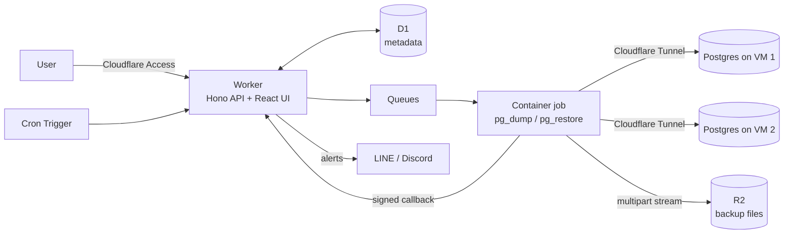

# Cellar

> Every Postgres, aged and kept safe.

**Cellar** is an open source, Cloudflare-native platform that backs up all your self-hosted PostgreSQL databases to Cloudflare R2 from one place. Register a connection, pick a schedule and a retention policy, and Cellar handles the rest: scheduled dumps, automatic cleanup of expired backups, one-click restore, and alerts when something breaks.

> **Status:** early development. APIs, schema, and configuration may change before v1.0.

---

## Why Cellar?

A common setup for small teams and freelancers looks like this:

```
VM 1: docker-compose -> web + api + postgres
VM 2: docker-compose -> web + api + postgres
VM 3: docker-compose -> web + api + postgres
...
```

Each database lives inside its own compose stack, and nobody backs them up because setting up cron + pg_dump + upload + cleanup on every VM is tedious and easy to forget. When a disk dies, the data is gone.

Cellar moves backup into a single control plane:

- **One dashboard** for every database across every VM
- **No open Postgres ports**, databases are reached through Cloudflare Tunnel
- **No servers to run** for the platform itself, it runs on Workers, D1, R2, Queues, and Containers
- **No custom login**, Cloudflare Zero Trust (Access) protects the app

## Features

- **Scheduled backups** - cron expression per database, timezone aware
- **Backup now** - trigger an on-demand backup from the UI
- **Streaming dumps** - `pg_dump -Fc` is streamed straight to R2 via multipart upload, no full buffering on disk or in memory
- **Automatic version matching** - picks a `pg_dump` client that matches your server's major version (PostgreSQL 13 to 18)
- **GFS retention** - keep last N, plus daily, weekly, and monthly tiers, with optional max age
- **Automatic cleanup** - expired backups are deleted from R2 automatically (retention starts in dry-run mode, see [Retention](#retention-gfs))
- **Safety guard** - the most recent successful backup of a database is never deleted
- **Restore** - restore a backup into a registered database that has a restore connection URL, with typed-name confirmation
- **Download** - short-lived presigned links (15 minutes max)
- **Alerts** - LINE and Discord notifications on failure, repeated failures, or "no successful backup in X hours"
- **Encrypted secrets** - connection URLs and tokens are encrypted at rest (AES-256-GCM) and never shown again after saving
- **Audit log** - who created, changed, downloaded, or restored what, and when

## Architecture



| Component | Role |
|---|---|
| **Worker** (Hono) | REST API, Access JWT verification, scheduling, retention, alerts, serves the UI |
| **React + Vite SPA** | Dashboard, served via Workers Static Assets |
| **D1** (Drizzle ORM) | Targets, backup runs, policies, alert channels, audit log |
| **Queues** | Job dispatch with per-target and global concurrency limits |
| **Containers** | Run `pg_dump`, `pg_restore`, and connection tests (Workers cannot run these binaries) |
| **R2** | Backup storage |
| **Cloudflare Tunnel** | Private path from Cloudflare to each VM's Postgres, no inbound ports |
| **Cloudflare Access** | Authentication and authorization for the dashboard |

### How a backup runs

1. Every minute, the Cron Trigger finds databases that are due and enqueues jobs.
2. The Queue consumer starts a Container job (one running job per database at a time).
3. The container connects to Postgres through the Tunnel, detects the server version, and streams `pg_dump -Fc` to R2 while computing a sha256 checksum.
4. The container reports the result (size, checksum, duration, errors) to the Worker via a signed callback.
5. On success, retention runs for that database. On failure, alerts fire.

### Storage layout

```
backups/{targetId}/{YYYY}/{MM}/{DD}/{ISO-timestamp}_{dbname}.dump
```

Backups use the PostgreSQL custom format (`-Fc`), which is compressed and restorable with `pg_restore`.

## Requirements

- A Cloudflare account with access to Workers, D1, R2, Queues, and Containers (Containers require a Workers Paid plan)
- Cloudflare Zero Trust (the free tier is enough for small teams)
- [Bun](https://bun.sh) (`bun install` also installs [Wrangler](https://developers.cloudflare.com/workers/wrangler/))
- Docker (to build the container image locally)
- PostgreSQL 13 or newer on your VMs

## Quick start

### 1. Clone and install

```bash
git clone https://github.com/theerakarnm/cellar.git
cd cellar
bun install
```

### 2. Create Cloudflare resources

```bash
bunx wrangler login
bunx wrangler d1 create cellar
bunx wrangler r2 bucket create cellar-backups
bunx wrangler queues create cellar-jobs
```

Copy the generated IDs into `wrangler.jsonc`.

### 3. Run database migrations

```bash
bun run db:migrate:remote
```

### 4. Create the R2 API token and set configuration

Cellar's container writes backups to R2 with an S3 API token.
Give it as little access as possible:

1. In the Cloudflare dashboard, go to **R2 > Manage API tokens** and create an API token.
2. Set the permission to **Object Read and Write**.
3. Limit the token to the bucket `cellar-backups` only.
   Never use an account-wide token.
4. Copy the **Access Key ID** and the **Secret Access Key**.
   The secret is shown only once.

Cellar hands this token to each job at run time.
It is never put in the image, in queue messages, or in logs.
See the [R2 token docs](https://developers.cloudflare.com/r2/api/tokens/).

Set the secrets:

```bash
bunx wrangler secret put ENCRYPTION_KEY          # 32-byte base64 key, see below
bunx wrangler secret put ACCESS_TEAM_DOMAIN      # e.g. yourteam.cloudflareaccess.com
bunx wrangler secret put ACCESS_AUD              # Access application AUD tag
bunx wrangler secret put R2_ACCESS_KEY_ID        # from the R2 token
bunx wrangler secret put R2_SECRET_ACCESS_KEY    # from the R2 token
```

Set the plain values in the `vars` block of `wrangler.jsonc`:

```jsonc
"vars": {
  "R2_ENDPOINT": "https://<account-id>.r2.cloudflarestorage.com",
  "R2_BUCKET": "cellar-backups",
  "APP_BASE_URL": "https://cellar.example.com"
}
```

| Name | Kind | Meaning |
|---|---|---|
| `ENCRYPTION_KEY` | secret | Base64 of 32 random bytes. Encrypts stored credentials. |
| `ACCESS_TEAM_DOMAIN` | secret | Your Access team domain, hostname only. |
| `ACCESS_AUD` | secret | Audience (AUD) tag of the Cellar Access application. |
| `R2_ACCESS_KEY_ID` | secret | Access Key ID of the bucket-scoped R2 token. |
| `R2_SECRET_ACCESS_KEY` | secret | Secret Access Key of the same token. |
| `R2_ENDPOINT` | var | S3 endpoint of your R2 account. |
| `R2_BUCKET` | var | Name of the backup bucket. |
| `APP_BASE_URL` | var | Public URL of Cellar. Used for links in alerts. |
| `R2_REGION` | optional var | SigV4 region for download links. Leave it empty for R2 (it uses `auto`). |
| `CALLBACK_BASE_URL` | optional var | Public Worker URL for container callbacks. Leave it empty (see Access setup). |
| `DEV_BYPASS` | local only | `true` skips Access for requests to `localhost`. Never set it in production. |

Generate an encryption key:

```bash
openssl rand -base64 32
```

> **Keep `ENCRYPTION_KEY` safe.** If you lose it, stored connection URLs cannot be decrypted and every database must be re-registered. Backups in R2 are not affected.

For local development, copy `.dev.vars.example` to `.dev.vars` and fill in the values.

### 5. Deploy

```bash
bun run deploy
```

### 6. Protect the app with Cloudflare Access

1. In Zero Trust, go to **Access > Applications > Add an application > Self-hosted**.
2. Set the application domain to your Cellar hostname.
3. Add a policy (for example, allow emails ending in `@yourcompany.com`).
4. Copy the **Application Audience (AUD) tag** into the `ACCESS_AUD` secret.

Cellar verifies the Access JWT on every `/api` request, except `GET /api/health`, which returns only `{ "ok", "version" }` (nothing about targets or config).
Requests without a valid token are rejected with `401`.

The container reports job results to the Worker through an outbound handler inside Cloudflare, not over the public internet.
The route `/internal/jobs/callback` is outside `/api`, is not covered by the Access check, and accepts only requests with a valid HMAC signature.
You do not need an Access bypass for it.

> **To verify at first deploy.** The outbound handler path has not been verified on Cloudflare yet.
> Run one backup and one connection test on your first deploy.
> If the callback never arrives, set `CALLBACK_BASE_URL` to the public Worker URL and add an Access bypass for the exact path `/internal/jobs/callback` only.

## Connecting a database (per VM)

Do this once for each VM that hosts a database.
The full guide is [docs/vm-onboarding.md](docs/vm-onboarding.md).
Cellar reaches Postgres only through Cloudflare Tunnel.

1. **Tunnel.** Add `cloudflared` to the VM's docker-compose stack and create a public TCP hostname for Postgres.
   Postgres needs no published port.
2. **Access.** Protect that hostname with an Access application that allows only a Cellar **service token**.
3. **Backup role.** Create a read-only role.
   The guide has the SQL for PostgreSQL 14 and newer (`pg_read_all_data`) and for PostgreSQL 13 (explicit grants).
4. **Restore role.** Prepare a role that can drop and create objects in the destination database.
   Cellar needs this as a separate restore URL.
5. **Register it.** In the dashboard, select **Add database** and fill in the connection details, schedule, retention, and alert channels.
   The dashboard saves a new database as disabled.
   Save it, select **Test connection** on its page, and enable it when the test passes.

> **To verify at first deploy.** The tunnel path has not been run against a real tunnel yet.
> Cellar has been tested against local stand-ins only.
> Run **Test connection** on one real database first.

## Retention (GFS)

Each database has its own policy:

| Setting | Meaning |
|---|---|
| `keep_last` | Keep the N newest successful backups |
| `daily` | Keep the newest backup of each of the last N days that have a backup |
| `weekly` | Keep the newest backup of each of the last N ISO weeks that have a backup (Monday start) |
| `monthly` | Keep the newest backup of each of the last N calendar months that have a backup |
| `max_age_days` | Optional. Backups older than this are not kept by any rule, except the latest successful backup |

Days, weeks, and months are counted in the database's time zone.
A rule that is empty or `0` is off.
Failed and timed-out backups are never counted and never deleted by retention.

A backup is kept if **any** rule keeps it.
Everything else is deleted from R2 first, and then its D1 row is soft-deleted.
The row stays for the audit trail.

Example: `keep_last=3, daily=7, weekly=4, monthly=6` with one backup per day keeps 14 backups once there are about five months of backups.
It keeps 10 with one month of backups and 13 with four months.

Retention runs after every successful backup and once a day.
Each run deletes at most 50 backups.
The target page shows a **retention preview** of what the next run would delete.

> **Dry run is on by default.**
> Until you turn it off in **Settings**, retention only logs what it would delete and deletes nothing.
> Check the retention preview first.

**Safety rule:** the most recent successful backup of a database is never deleted, regardless of policy.

## Restoring a backup

1. Open the database, choose a backup from the history, and select **Restore**.
2. Choose the destination database.
   It must have a restore connection URL.
3. Type the destination name to confirm.
   This is always required.
4. If the destination is the source database, also tick the overwrite acknowledgement.
   Without it the API answers `400`.

Cellar has no default destination and never creates a database.
The database name comes from the restore URL.
It streams the dump from R2 into:

```bash
pg_restore --clean --if-exists --no-owner --no-password --dbname <destination>
```

Cellar picks the `pg_restore` that matches the destination server's major version.

> Restoring with `--clean` drops and recreates objects in the destination.
> When the destination is the source database, the dialog asks you to confirm the overwrite.
> A restore is rejected with `409` while the destination has a backup or a restore running.
> Test restores into a scratch database first.

To restore by hand, or to check a restore, follow [docs/restore-runbook.md](docs/restore-runbook.md).

## Alerts

Configure channels under **Settings**, in the **Alert channels** section:

- **LINE** - Messaging API channel access token and the recipient ID (`to`), a user, group, or room
- **Discord** - webhook URL.
  It must start with `https://discord.com/api/webhooks/` or `https://discordapp.com/api/webhooks/`.
  Other URLs are rejected.

Link each database to the channels that should alert for it, on the database form.
A channel can be linked to many databases, and a database can have many channels.
A database with no linked channel sends no alerts.

Alerts fire for these events:

- `backup_failed` - a backup fails or times out.
  Sent every time.
- `backup_consecutive_failures` - a database fails N times in a row.
  N is set per database (default 3).
  Sent once, until a backup succeeds.
- `backup_stale` - a database has no successful backup within its stale limit.
  Sent once per stale period.

The stale limit is the value of `stale after hours` on the database, when you set it.
If you leave it empty, the limit is the expected gap between scheduled runs plus 2 hours.
A daily schedule therefore goes stale after 26 hours.

Each message names the database and its project tag, the event, a short redacted error, the time in the database's time zone, and a link to its page.
Alert messages never include connection strings or passwords.

> **Not tested yet.** Real LINE and Discord delivery has not been tested.
> Send a test message from the channel settings before you rely on it.

## Security

- **Authentication:** Cloudflare Access.
  The Worker checks the JWT signature, audience, and expiry on every `/api` request, except `GET /api/health`.
- **Network:** Postgres stays private behind Cloudflare Tunnel, with no public ports.
- **Secrets at rest:** connection URLs, service tokens, and alert credentials are encrypted with AES-256-GCM before they are stored in D1.
- **Secrets in transit:** the API never returns a saved secret in plaintext.
  Secrets are redacted from logs, errors, and alerts.
- **Least privilege:** use a read-only role for backups and a separate, bucket-scoped R2 token.
- **Downloads:** presigned URLs last at most 15 minutes and are sent with `Cache-Control: no-store`.
  Each download is written to the audit log, without the URL.
- **Container callbacks:** each job has its own key, derived from `ENCRYPTION_KEY`.
  Callbacks are signed with HMAC-SHA256 and must arrive within 5 minutes.
  Each callback carries a sequence number, so an old result cannot replace a newer one.

Found a vulnerability?
Please do not open a public issue.
See [SECURITY.md](SECURITY.md).

## Limits and considerations

- Backup speed depends on the Tunnel and the container's network throughput.
  Very large databases (hundreds of GB) may hit container runtime limits.
  Check the current [Cloudflare Containers limits](https://developers.cloudflare.com/containers/) for your plan.
- Cellar makes logical backups with `pg_dump`.
  It does not do point-in-time recovery (PITR) or WAL archiving.
  For that, look at tools like pgBackRest or WAL-G.
- R2 storage is billed by Cloudflare.
  Retention policies directly control your storage cost.
  The dashboard shows the total backup size and the size of each database.
- Backups are uploaded in multipart parts of 32 MiB by default.
  R2 allows at most 10,000 parts per upload, so Cellar uses larger parts for a large database.
  A part is at most 128 MiB, so one dump can be up to about 1.2 TiB.
- Add an R2 bucket lifecycle rule that aborts incomplete multipart uploads after 1 day.
  Cellar does not create this rule for you.
  See the Cloudflare docs on [R2 object lifecycles](https://developers.cloudflare.com/r2/buckets/object-lifecycles/).
- At most 2 containers run at once (`max_instances` in `wrangler.jsonc`).
  Backups run at most `max_concurrent_jobs` at a time.
  This is a global setting, 1 by default, up to 10.
  Restores and connection tests do not count toward it, so one container stays free for them.
- Every new database uses the schedule `0 2 * * *` (02:00) by default.
  With one backup at a time, give databases different schedules, or raise `max_concurrent_jobs`.

## Development

```bash
bun install
cp .dev.vars.example .dev.vars    # fill in fake values; DEV_BYPASS=true skips Access on localhost
bun run db:migrate:local
bun run dev                       # Worker (wrangler dev) and UI (Vite) together
bun run test                      # Vitest
bun run typecheck
```

`bun run dev` needs Docker, because the job container runs under `wrangler dev`.
Without Docker, you can start the Worker with `bunx wrangler dev --enable-containers=false`.
Backups and connection tests cannot run in that mode.

Project layout:

```
cellar/
├── src/
│   ├── worker/       # Hono API, cron, queue consumer, retention, alerts
│   └── shared/       # Code shared by the Worker and the UI
├── ui/               # React + Vite dashboard
├── container/        # Dockerfile and job runner (pg_dump / pg_restore)
├── migrations/       # Drizzle migrations for D1
├── test/             # Vitest tests, mirrors the source folders
├── docs/             # Plan, runbooks, onboarding guide
├── wrangler.jsonc
└── .dev.vars.example
```

The retention logic lives in a pure function, `selectBackupsToDelete(backups, policy, now, tz)`, with full unit test coverage.
Any change to retention must include tests.

## Roadmap

- [ ] v0.1 - targets, scheduled backups, R2 upload, retention
- [ ] v0.2 - restore, download, alerts
- [ ] v0.3 - dashboard polish, audit log viewer
- [ ] Later - backup verification (automatic test restores), client-side encryption of dump files, per-project access rules, more alert channels

## Contributing

Contributions are welcome. Please read [CONTRIBUTING.md](CONTRIBUTING.md) before opening a pull request.

1. Fork the repo and create a branch
2. Make your change with tests
3. Run `bun run test` and `bun run typecheck`
4. Open a pull request describing what and why

## License

[MIT](LICENSE)
